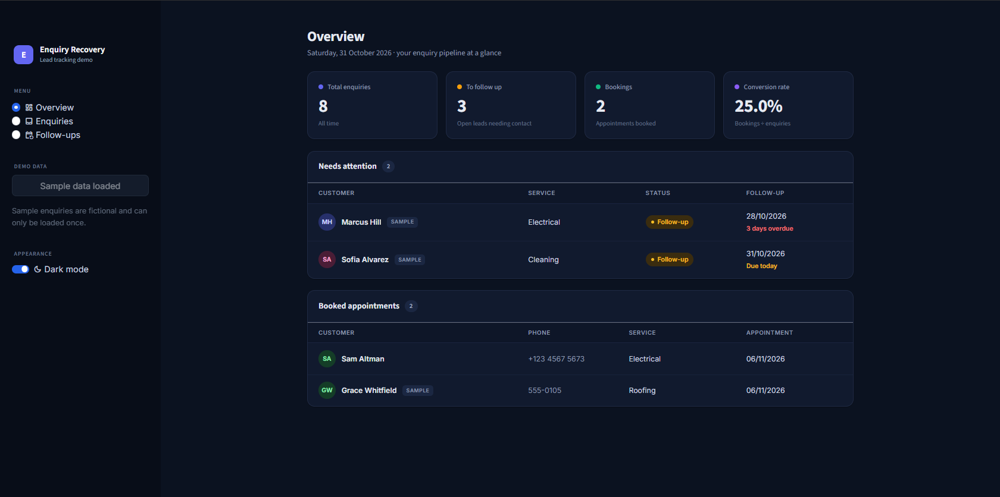
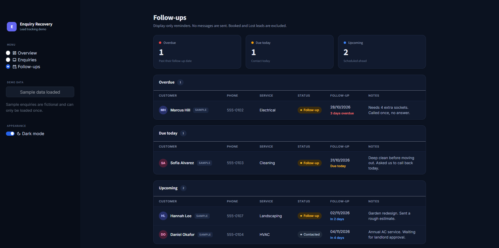

# Enquiry Recovery System

**A simple lead management and follow-up dashboard for home-service businesses.**

Never lose track of an enquiry again.

Enquiry Recovery helps businesses organise incoming customer enquiries, track their progress, manage follow-ups and monitor booking outcomes from one dashboard.

> Portfolio demonstration project. All sample data is fictional.

---

## What it does

- **Capture enquiries:** Record customer details and the service they're interested in.
- **Manage leads:** Track each enquiry through New, Contacted, Follow-up, Booked or Lost.
- **Track follow-ups:** Organise pending follow-ups into overdue, due today and upcoming.
- **Monitor bookings:** Record appointment dates for booked enquiries.
- **View performance:** Monitor enquiries, pending follow-ups, bookings and conversion rate.

## Preview

### 1. Dashboard



### 2. Current Enquiries


### 3. New Enquiry


### 4. Follow-ups



## Built with

| Technology | Purpose |
|---|---|
| Python | Application logic |
| Streamlit | User interface |
| SQLite | Local data storage |

## Getting started

### 1. Clone the repository

```bash
git clone YOUR_REPOSITORY_URL
cd enquiry-recovery-system
```

### 2. Install dependencies

```bash
pip install -r requirements.txt
```

### 3. Run the application

```bash
streamlit run app.py
```

The application creates its SQLite database automatically next to `app.py`.

## Project structure

```text
enquiry-recovery-system/
├── app.py
├── database.py
├── requirements.txt
├── README.md
└── .streamlit/
    └── config.toml
```

## Current limitations

- Designed for a single local user.
- No authentication or multi-user support.
- No automated email, SMS or WhatsApp notifications.
- No delete or export functionality.
- Follow-up reminders are displayed inside the application.

## Project status

A functional portfolio prototype demonstrating lead management, follow-up tracking, SQLite persistence and basic business analytics.
